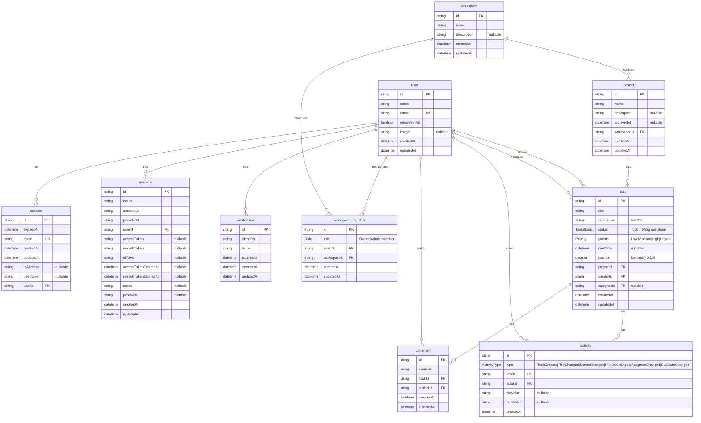

# Database ERD — Mini Jira

Sơ đồ quan hệ sinh từ `prisma/schema.prisma` (Mốc 1). Mở file này trong VS Code (cài extension *Markdown Preview Mermaid Support*) hoặc xem trên GitHub để render sơ đồ.

> Ghi chú: `user`, `session`, `account`, `verification` là bảng auth của Better Auth, giữ nguyên. Các bảng còn lại là nghiệp vụ thêm ở Mốc 1.

## Quan hệ & cascade

| Quan hệ | Cardinality | onDelete |
|---|---|---|
| User -> WorkspaceMember | 1 : N | Cascade |
| Workspace -> WorkspaceMember | 1 : N | Cascade |
| Workspace -> Project | 1 : N | Cascade |
| Project -> Task | 1 : N | Cascade |
| User -> Task (creator) | 1 : N | Restrict |
| User -> Task (assignee) | 1 : N | SetNull |
| Task -> Comment | 1 : N | Cascade |
| User -> Comment (author) | 1 : N | Restrict |
| Task -> Activity | 1 : N | Cascade |
| User -> Activity (actor) | 1 : N | Restrict |

> Chính sách: khi xoá tài khoản, **không xoá theo** dữ liệu nghiệp vụ. Task/comment/activity được bảo toàn — `creator`/`author`/`actor` dùng Restrict (chặn xoá user còn tham chiếu), `assignee` dùng SetNull (chỉ nhả). Chỉ `WorkspaceMember` là Cascade (membership thuần phụ thuộc user).

## Ràng buộc quan trọng

- `workspace_member`: `UNIQUE (userId, workspaceId)` — membership duy nhất (BR-002).
- `task.position`: `Decimal(40,20)` — thứ tự fractional trong cột status (BR-017).
- `project.archivedAt != null` ⇔ project archived (archive mềm, BR-012); permanent delete chỉ Owner (BR-013).
- Activity **immutable** — không có update/delete (BR-015).
- "Đúng một Owner/workspace" (BR-001) và "assignee là member cùng workspace" (BR-007) được thực thi ở lớp service, không phải DB constraint.
